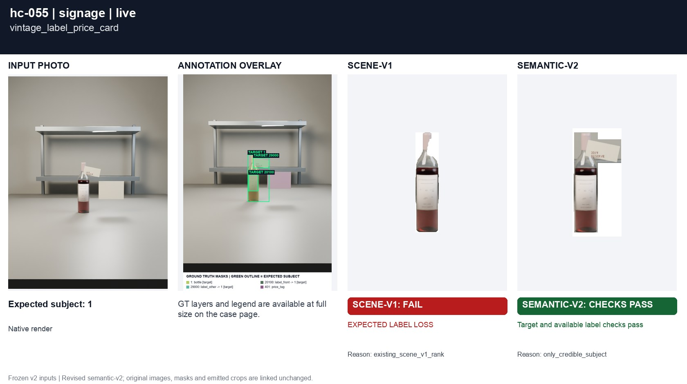
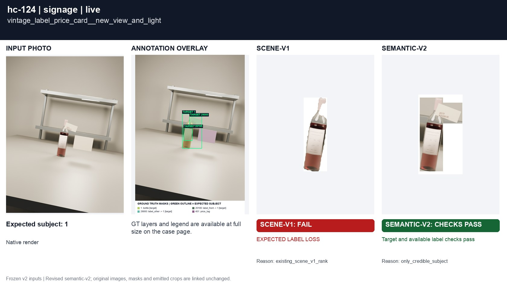
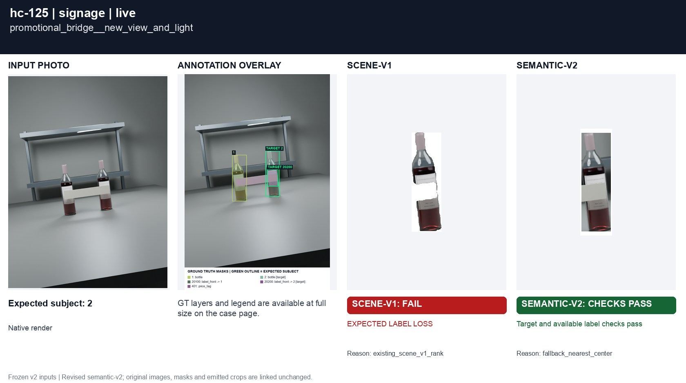

# Small wine information beside large signage

[All groups](../README.md)

A small vintage label with a large price card, and a promotional strip between bottles. Shelf signage is not a wine label.

4 cases. Failures below use frozen result fields; photos and fixtures retain separate interpretation.

| Case | scene-v1 | semantic-v2 |
|---|---|---|
| [hc-055 vintage_label_price_card](../cases/hc-055.md) | **FAIL** live: EXPECTED LABEL LOSS | Recorded checks pass |
| [hc-056 promotional_bridge](../cases/hc-056.md) | **FAIL** controlled: WRONG TARGET; EXPECTED LABEL LOSS, live: WRONG TARGET; EXPECTED LABEL LOSS | Recorded checks pass |
| [hc-124 vintage_label_price_card__new_view_and_light](../cases/hc-124.md) | **FAIL** live: EXPECTED LABEL LOSS | Recorded checks pass |
| [hc-125 promotional_bridge__new_view_and_light](../cases/hc-125.md) | **FAIL** live: EXPECTED LABEL LOSS | Recorded checks pass |

## Visual examples

### hc-055 vintage_label_price_card

**scene-v1:** **FAIL** live: EXPECTED LABEL LOSS

[Open original photo, all masks and every selector crop](../cases/hc-055.md)

### hc-056 promotional_bridge

**scene-v1:** **FAIL** controlled: WRONG TARGET; EXPECTED LABEL LOSS, live: WRONG TARGET; EXPECTED LABEL LOSS

[Open original photo, all masks and every selector crop](../cases/hc-056.md)

### hc-124 vintage_label_price_card__new_view_and_light

**scene-v1:** **FAIL** live: EXPECTED LABEL LOSS

[Open original photo, all masks and every selector crop](../cases/hc-124.md)

### hc-125 promotional_bridge__new_view_and_light

**scene-v1:** **FAIL** live: EXPECTED LABEL LOSS

[Open original photo, all masks and every selector crop](../cases/hc-125.md)

