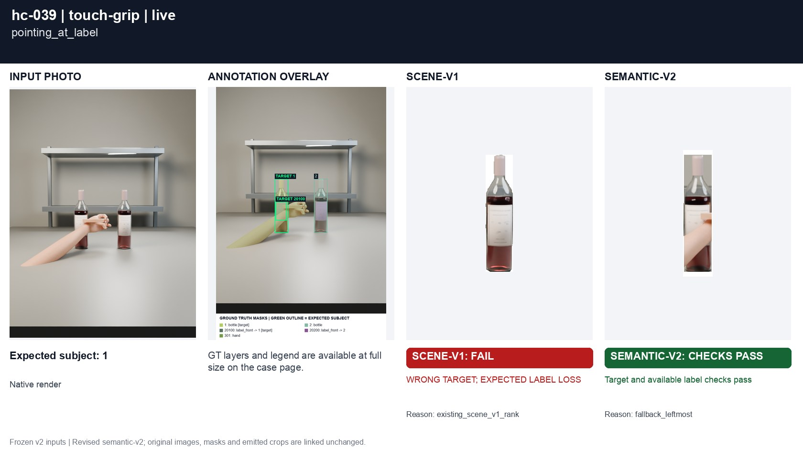
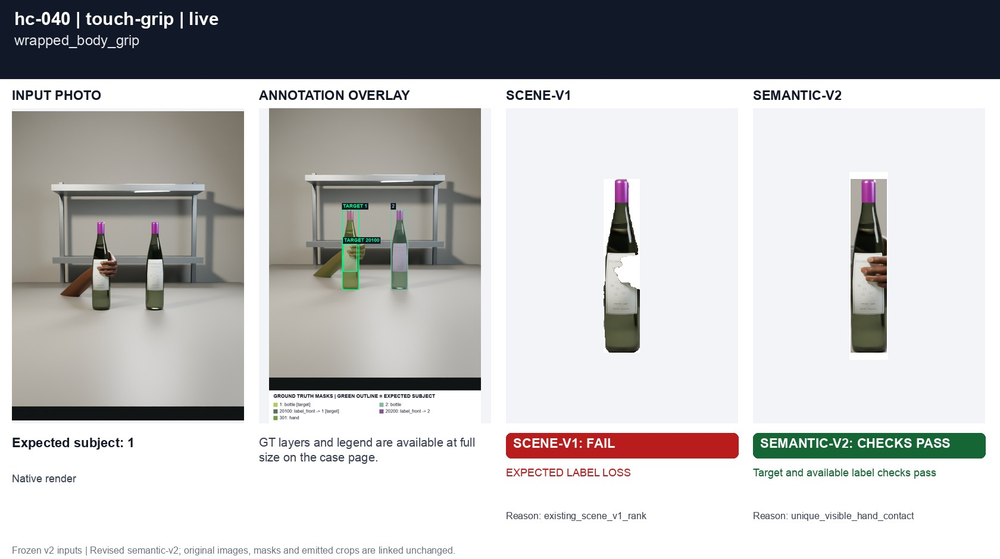
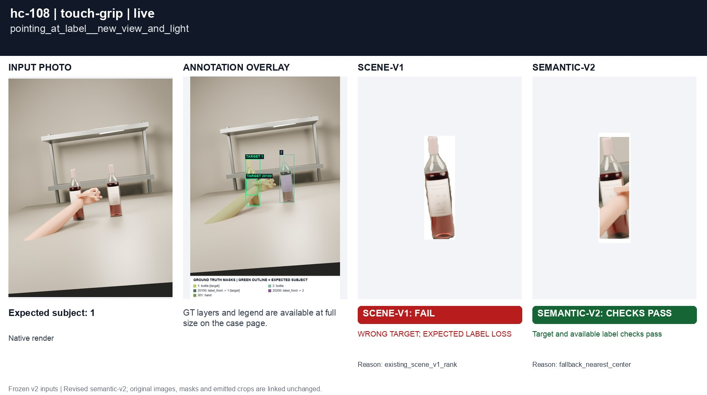
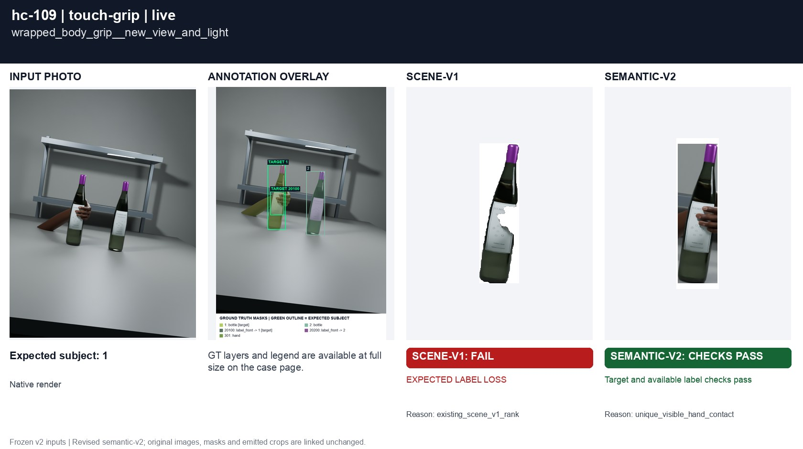

# Pointing, reaching and gripping

[All groups](../README.md)

A pointing finger touches a label versus a wrapped grip. Visible adjacency alone cannot prove a grip.

4 cases. Failures below use frozen result fields; photos and fixtures retain separate interpretation.

| Case | scene-v1 | semantic-v2 |
|---|---|---|
| [hc-039 pointing_at_label](../cases/hc-039.md) | **FAIL** live: WRONG TARGET; EXPECTED LABEL LOSS | Recorded checks pass |
| [hc-040 wrapped_body_grip](../cases/hc-040.md) | **FAIL** live: EXPECTED LABEL LOSS | Recorded checks pass |
| [hc-108 pointing_at_label__new_view_and_light](../cases/hc-108.md) | **FAIL** live: WRONG TARGET; EXPECTED LABEL LOSS | Recorded checks pass |
| [hc-109 wrapped_body_grip__new_view_and_light](../cases/hc-109.md) | **FAIL** live: EXPECTED LABEL LOSS | Recorded checks pass |

## Visual examples

### hc-039 pointing_at_label

**scene-v1:** **FAIL** live: WRONG TARGET; EXPECTED LABEL LOSS

[Open original photo, all masks and every selector crop](../cases/hc-039.md)

### hc-040 wrapped_body_grip

**scene-v1:** **FAIL** live: EXPECTED LABEL LOSS

[Open original photo, all masks and every selector crop](../cases/hc-040.md)

### hc-108 pointing_at_label__new_view_and_light

**scene-v1:** **FAIL** live: WRONG TARGET; EXPECTED LABEL LOSS

[Open original photo, all masks and every selector crop](../cases/hc-108.md)

### hc-109 wrapped_body_grip__new_view_and_light

**scene-v1:** **FAIL** live: EXPECTED LABEL LOSS

[Open original photo, all masks and every selector crop](../cases/hc-109.md)

