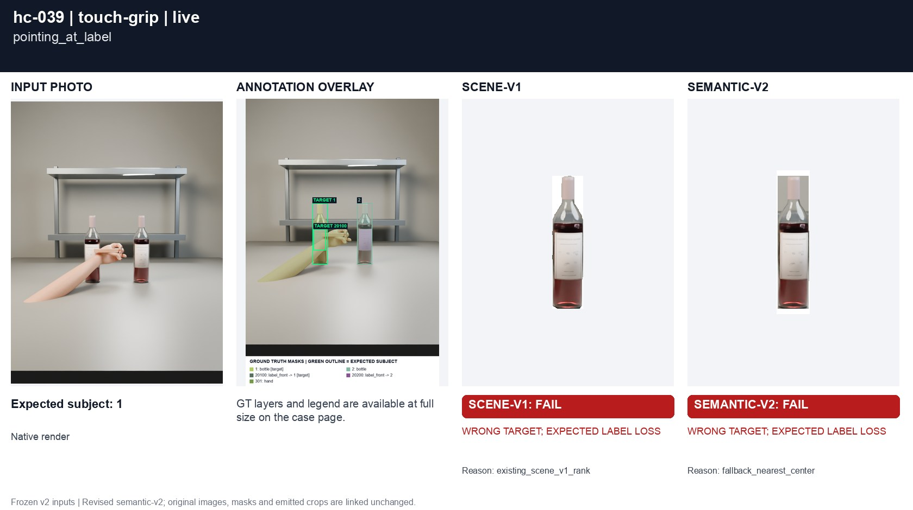
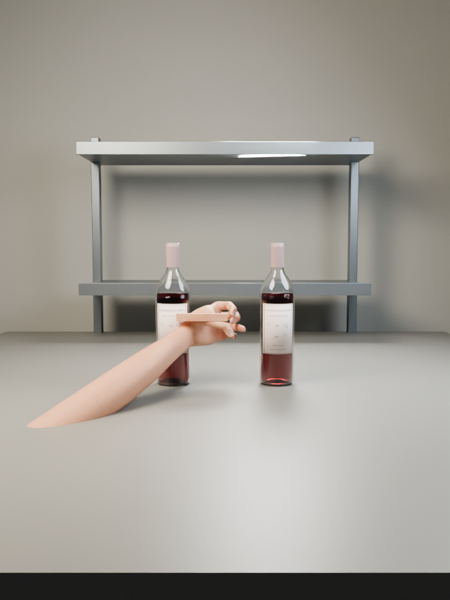
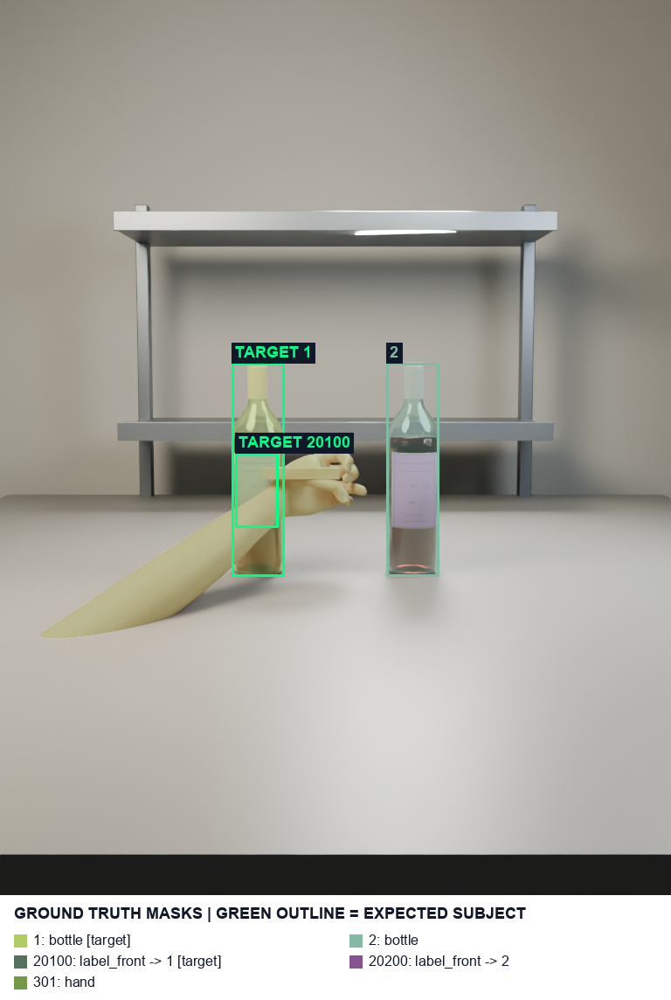
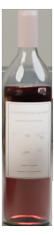
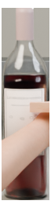

# hc-039 pointing_at_label

[All cases](../README.md) · [Group](../groups/touch-grip.md) · [Exact case metadata](../evidence/hc-039.json)

**scene-v1:** **FAIL** live: WRONG TARGET; EXPECTED LABEL LOSS  
**semantic-v2:** **FAIL** live: WRONG TARGET; EXPECTED LABEL LOSS

## Expected result

- Group: `touch-grip`; provenance: `new_native_render`.
- Expected subject: `1`; acceptable IDs: `[1, 2]`.
- Expected status: `selected`; expected selection mode: `fallback`.
- Interaction: `{}`.
- Annotation source: native opaque visible geometry.
- Complete label GT: `True`.

No unique intended bottle. The annotated crop target follows the revised photo-center / pixel-distance / left / upper policy; this is a product fallback, not evidence of user intent.

## Original input and masks

| Mask ID | Category | Parent | Expected subject or label | Original binary PNG |
|---|---|---|---|---|
| `1` | bottle | `None` | yes | [view raw mask](../assets/masks/hc-039-i1.png) |
| `2` | bottle | `None` |  | [view raw mask](../assets/masks/hc-039-i2.png) |
| `20100` | label_front | `1` | yes | [view raw mask](../assets/masks/hc-039-i20100.png) |
| `20200` | label_front | `2` |  | [view raw mask](../assets/masks/hc-039-i20200.png) |
| `301` | hand | `None` |  | [view raw mask](../assets/masks/hc-039-i301.png) |

## Saved selector outputs

`live` replays saved detector responses; `controlled` uses declared GT-derived detections and faults. No new inference was run for this gallery. Expected-label retention below 98% is flagged separately from target matching. A full-frame crop can retain distractors.

### live

| Selector | Result | Assigned subject | Mode | Expected-label retention | Reason |
|---|---|---|---|---|---|
| `scene-v1` | **FAIL: WRONG TARGET, EXPECTED LABEL LOSS** | `2` | `legacy` | 0.00% | `existing_scene_v1_rank` |
| `semantic-v2` | **FAIL: WRONG TARGET, EXPECTED LABEL LOSS** | `2` | `fallback` | 0.00% | `fallback_nearest_center` |

#### scene-v1 live crop

[View original selector keep mask](../assets/crops/hc-039-live-scene-v1-keep.png)

#### semantic-v2 live crop

[View original selector keep mask](../assets/crops/hc-039-live-semantic-v2-keep.png)

Label crop views: [view 1](../assets/crops/hc-039-live-semantic-v2-label-0.png).
### controlled

| Selector | Result | Assigned subject | Mode | Expected-label retention | Reason |
|---|---|---|---|---|---|
| `scene-v1` | Recorded checks pass | `1` | `legacy` | 100.00% | `existing_scene_v1_rank` |
| `semantic-v2` | Recorded checks pass | `1` | `fallback` | 100.00% | `fallback_leftmost` |

#### scene-v1 controlled crop

[View original selector keep mask](../assets/crops/hc-039-controlled-scene-v1-keep.png)

#### semantic-v2 controlled crop

[View original selector keep mask](../assets/crops/hc-039-controlled-semantic-v2-keep.png)

Label crop views: [view 1](../assets/crops/hc-039-controlled-semantic-v2-label-0.png).

## Remaining live detector/GT mismatch

**UNRESOLVED: `detector_vs_gt_fallback_geometry`.** The frozen detector geometry breaks the GT policy tie or ordering differently. The selected ID matches the independently recomputed exact detector fallback. Changing it to the GT ID would require changing geometry, tolerance or the agreed policy.

The exact detector fallback independently recomputes to `d0`. This is separate from the frozen GT target.

[Full audit with boxes, center tests, distances, GT assignments and IoUs](../evidence/residual-failures.json).

| Detector source index | Class | Score | Input box | Exact detector mask |
|---|---|---:|---|---|
| `d0` | wine bottle | 0.939453125 | `[444.0, 413.0, 501.0, 658.0]` | [raw mask](../detector-masks/hc-039-d0.png) |
| `d1` | wine bottle | 0.93701171875 | `[266.0, 413.0, 323.0, 658.0]` | [raw mask](../detector-masks/hc-039-d1.png) |
| `d2` | wine label | 0.95556640625 | `[447.0, 517.0, 500.0, 604.0]` | [raw mask](../detector-masks/hc-039-d2.png) |
| `d3` | wine label | 0.853515625 | `[267.0, 517.0, 321.0, 580.0]` | [raw mask](../detector-masks/hc-039-d3.png) |
| `d4` | hand | 0.8876953125 | `[309.0, 513.0, 420.0, 592.0]` | [raw mask](../detector-masks/hc-039-d4.png) |
