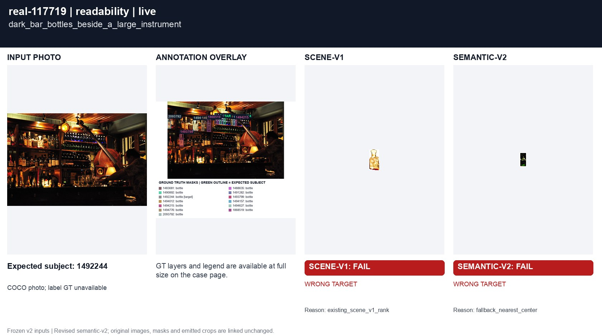
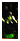

# real-117719 dark_bar_bottles_beside_a_large_instrument

[All cases](../README.md) · [Group](../groups/readability.md) · [Exact case metadata](../evidence/real-117719.json)

**scene-v1:** **FAIL** live: WRONG TARGET  
**semantic-v2:** **FAIL** live: WRONG TARGET

## Expected result

- Group: `readability`; provenance: `coco_real_photo`.
- Expected subject: `1492244`; acceptable IDs: `[1483681, 1488635, 1490892, 1491282, 1492244, 1493799, 1494012, 1494157, 1494215, 1494627, 1494776, 1868519, 2093792]`.
- Expected status: `selected`; expected selection mode: `fallback`.
- Interaction: `{}`.
- Annotation source: COCO bottle polygons; Codex visual target review before evaluation, not independently adjudicated; background instance coverage can be incomplete.
- Complete label GT: `False`.

No unique intended bottle. The annotated crop target follows the revised photo-center / pixel-distance / left / upper policy; this is a product fallback, not evidence of user intent.

COCO image `117719` · [original source](http://images.cocodataset.org/val2017/000000117719.jpg) · [Flickr source](http://farm4.staticflickr.com/3395/3499231904_8b958aa5bc_z.jpg) · [license: Attribution-ShareAlike License](http://creativecommons.org/licenses/by-sa/2.0/).

Real targets are developer judgments, not independently adjudicated user intent. COCO competitor coverage may be incomplete; no hand or complete-label ground truth is invented.

## Original input and masks

| Mask ID | Category | Parent | Expected subject or label | Original binary PNG |
|---|---|---|---|---|
| `1483681` | bottle | `None` |  | [view raw mask](../assets/masks/real-117719-i1483681.png) |
| `1488635` | bottle | `None` |  | [view raw mask](../assets/masks/real-117719-i1488635.png) |
| `1490892` | bottle | `None` |  | [view raw mask](../assets/masks/real-117719-i1490892.png) |
| `1491282` | bottle | `None` |  | [view raw mask](../assets/masks/real-117719-i1491282.png) |
| `1492244` | bottle | `None` | yes | [view raw mask](../assets/masks/real-117719-i1492244.png) |
| `1493799` | bottle | `None` |  | [view raw mask](../assets/masks/real-117719-i1493799.png) |
| `1494012` | bottle | `None` |  | [view raw mask](../assets/masks/real-117719-i1494012.png) |
| `1494157` | bottle | `None` |  | [view raw mask](../assets/masks/real-117719-i1494157.png) |
| `1494215` | bottle | `None` |  | [view raw mask](../assets/masks/real-117719-i1494215.png) |
| `1494627` | bottle | `None` |  | [view raw mask](../assets/masks/real-117719-i1494627.png) |
| `1494776` | bottle | `None` |  | [view raw mask](../assets/masks/real-117719-i1494776.png) |
| `1868519` | bottle | `None` |  | [view raw mask](../assets/masks/real-117719-i1868519.png) |
| `2093792` | bottle | `None` |  | [view raw mask](../assets/masks/real-117719-i2093792.png) |

## Saved selector outputs

`live` replays saved detector responses; `controlled` uses declared GT-derived detections and faults. No new inference was run for this gallery. Expected-label retention below 98% is flagged separately from target matching. A full-frame crop can retain distractors.

### live

| Selector | Result | Assigned subject | Mode | Expected-label retention | Reason |
|---|---|---|---|---|---|
| `scene-v1` | **FAIL: WRONG TARGET** | `1494627` | `legacy` | not scored | `existing_scene_v1_rank` |
| `semantic-v2` | **FAIL: WRONG TARGET** | `None` | `fallback` | not scored | `fallback_nearest_center` |

#### scene-v1 live crop

[View original selector keep mask](../assets/crops/real-117719-live-scene-v1-keep.png)

#### semantic-v2 live crop

[View original selector keep mask](../assets/crops/real-117719-live-semantic-v2-keep.png)

## Remaining live detector/GT mismatch

**UNRESOLVED: `detector_vs_gt_fallback_geometry`.** The frozen detector geometry breaks the GT policy tie or ordering differently. The selected ID matches the independently recomputed exact detector fallback. Changing it to the GT ID would require changing geometry, tolerance or the agreed policy.

The exact detector fallback independently recomputes to `d7`. This is separate from the frozen GT target.

[Full audit with boxes, center tests, distances, GT assignments and IoUs](../evidence/residual-failures.json).

| Detector source index | Class | Score | Input box | Exact detector mask |
|---|---|---:|---|---|
| `d0` | wine bottle | 0.476806640625 | `[358.0, 95.0, 372.0, 132.0]` | [raw mask](../detector-masks/real-117719-d0.png) |
| `d1` | wine bottle | 0.599609375 | `[168.0, 261.0, 191.0, 340.0]` | [raw mask](../detector-masks/real-117719-d1.png) |
| `d2` | wine bottle | 0.40185546875 | `[343.0, 138.0, 357.0, 173.0]` | [raw mask](../detector-masks/real-117719-d2.png) |
| `d3` | wine bottle | 0.6259765625 | `[0.0, 93.0, 18.0, 148.0]` | [raw mask](../detector-masks/real-117719-d3.png) |
| `d4` | wine bottle | 0.61865234375 | `[219.0, 98.0, 237.0, 164.0]` | [raw mask](../detector-masks/real-117719-d4.png) |
| `d5` | wine bottle | 0.495849609375 | `[282.0, 88.0, 297.0, 125.0]` | [raw mask](../detector-masks/real-117719-d5.png) |
| `d6` | wine bottle | 0.45166015625 | `[370.0, 97.0, 384.0, 132.0]` | [raw mask](../detector-masks/real-117719-d6.png) |
| `d7` | wine bottle | 0.436279296875 | `[307.0, 134.0, 323.0, 171.0]` | [raw mask](../detector-masks/real-117719-d7.png) |
| `d8` | wine bottle | 0.51806640625 | `[138.0, 102.0, 165.0, 160.0]` | [raw mask](../detector-masks/real-117719-d8.png) |
| `d9` | wine bottle | 0.56298828125 | `[51.0, 190.0, 68.0, 244.0]` | [raw mask](../detector-masks/real-117719-d9.png) |
| `d10` | wine bottle | 0.6142578125 | `[66.0, 177.0, 86.0, 244.0]` | [raw mask](../detector-masks/real-117719-d10.png) |
| `d11` | wine bottle | 0.62060546875 | `[166.0, 187.0, 186.0, 248.0]` | [raw mask](../detector-masks/real-117719-d11.png) |
| `d12` | wine bottle | 0.62548828125 | `[202.0, 178.0, 221.0, 248.0]` | [raw mask](../detector-masks/real-117719-d12.png) |
| `d13` | wine bottle | 0.42822265625 | `[294.0, 133.0, 309.0, 169.0]` | [raw mask](../detector-masks/real-117719-d13.png) |
| `d14` | wine bottle | 0.5703125 | `[146.0, 190.0, 167.0, 244.0]` | [raw mask](../detector-masks/real-117719-d14.png) |
| `d15` | wine bottle | 0.556640625 | `[113.0, 108.0, 138.0, 157.0]` | [raw mask](../detector-masks/real-117719-d15.png) |
| `d16` | wine bottle | 0.5908203125 | `[17.0, 91.0, 39.0, 150.0]` | [raw mask](../detector-masks/real-117719-d16.png) |
| `d17` | wine bottle | 0.55078125 | `[149.0, 262.0, 171.0, 340.0]` | [raw mask](../detector-masks/real-117719-d17.png) |
| `d18` | wine bottle | 0.470947265625 | `[333.0, 93.0, 347.0, 130.0]` | [raw mask](../detector-masks/real-117719-d18.png) |
| `d19` | wine bottle | 0.625 | `[184.0, 101.0, 203.0, 162.0]` | [raw mask](../detector-masks/real-117719-d19.png) |
| `d20` | wine bottle | 0.60546875 | `[200.0, 98.0, 220.0, 163.0]` | [raw mask](../detector-masks/real-117719-d20.png) |
| `d21` | wine bottle | 0.65185546875 | `[91.0, 83.0, 113.0, 156.0]` | [raw mask](../detector-masks/real-117719-d21.png) |
| `d22` | wine bottle | 0.63916015625 | `[184.0, 181.0, 203.0, 247.0]` | [raw mask](../detector-masks/real-117719-d22.png) |
| `d23` | wine bottle | 0.59814453125 | `[102.0, 195.0, 126.0, 245.0]` | [raw mask](../detector-masks/real-117719-d23.png) |
| `d24` | wine bottle | 0.429443359375 | `[331.0, 135.0, 345.0, 172.0]` | [raw mask](../detector-masks/real-117719-d24.png) |
| `d25` | wine bottle | 0.654296875 | `[53.0, 79.0, 71.0, 152.0]` | [raw mask](../detector-masks/real-117719-d25.png) |
| `d26` | wine bottle | 0.599609375 | `[124.0, 191.0, 141.0, 245.0]` | [raw mask](../detector-masks/real-117719-d26.png) |
| `d27` | wine bottle | 0.4013671875 | `[282.0, 131.0, 297.0, 168.0]` | [raw mask](../detector-masks/real-117719-d27.png) |
| `d28` | wine bottle | 0.4775390625 | `[320.0, 92.0, 334.0, 129.0]` | [raw mask](../detector-masks/real-117719-d28.png) |
| `d29` | wine bottle | 0.58740234375 | `[164.0, 98.0, 186.0, 161.0]` | [raw mask](../detector-masks/real-117719-d29.png) |
| `d30` | wine bottle | 0.59228515625 | `[5.0, 187.0, 29.0, 243.0]` | [raw mask](../detector-masks/real-117719-d30.png) |
| `d31` | wine bottle | 0.438232421875 | `[438.0, 103.0, 454.0, 138.0]` | [raw mask](../detector-masks/real-117719-d31.png) |
| `d32` | wine bottle | 0.5458984375 | `[85.0, 197.0, 104.0, 245.0]` | [raw mask](../detector-masks/real-117719-d32.png) |
| `d33` | wine bottle | 0.55517578125 | `[70.0, 87.0, 90.0, 154.0]` | [raw mask](../detector-masks/real-117719-d33.png) |
| `d34` | wine bottle | 0.6337890625 | `[188.0, 262.0, 205.0, 339.0]` | [raw mask](../detector-masks/real-117719-d34.png) |
| `d35` | wine bottle | 0.6162109375 | `[219.0, 190.0, 237.0, 248.0]` | [raw mask](../detector-masks/real-117719-d35.png) |
| `d36` | wine bottle | 0.468017578125 | `[296.0, 89.0, 309.0, 126.0]` | [raw mask](../detector-masks/real-117719-d36.png) |
| `d37` | wine bottle | 0.49462890625 | `[307.0, 90.0, 320.0, 127.0]` | [raw mask](../detector-masks/real-117719-d37.png) |
| `d38` | wine bottle | 0.490478515625 | `[18.0, 271.0, 41.0, 342.0]` | [raw mask](../detector-masks/real-117719-d38.png) |
| `d39` | wine bottle | 0.46240234375 | `[344.0, 93.0, 359.0, 131.0]` | [raw mask](../detector-masks/real-117719-d39.png) |
| `d40` | wine bottle | 0.490966796875 | `[257.0, 87.0, 270.0, 123.0]` | [raw mask](../detector-masks/real-117719-d40.png) |
| `d41` | wine bottle | 0.499755859375 | `[268.0, 87.0, 283.0, 124.0]` | [raw mask](../detector-masks/real-117719-d41.png) |
| `d42` | wine label | 0.5478515625 | `[86.0, 217.0, 103.0, 242.0]` | [raw mask](../detector-masks/real-117719-d42.png) |
| `d43` | wine label | 0.654296875 | `[170.0, 301.0, 188.0, 329.0]` | [raw mask](../detector-masks/real-117719-d43.png) |
| `d44` | wine label | 0.7236328125 | `[0.0, 110.0, 18.0, 146.0]` | [raw mask](../detector-masks/real-117719-d44.png) |
| `d45` | wine label | 0.57275390625 | `[203.0, 127.0, 220.0, 162.0]` | [raw mask](../detector-masks/real-117719-d45.png) |
| `d46` | wine label | 0.4189453125 | `[54.0, 134.0, 70.0, 148.0]` | [raw mask](../detector-masks/real-117719-d46.png) |
| `d47` | wine label | 0.712890625 | `[52.0, 205.0, 68.0, 237.0]` | [raw mask](../detector-masks/real-117719-d47.png) |
| `d48` | wine label | 0.73583984375 | `[67.0, 211.0, 86.0, 242.0]` | [raw mask](../detector-masks/real-117719-d48.png) |
| `d49` | wine label | 0.40966796875 | `[104.0, 220.0, 125.0, 242.0]` | [raw mask](../detector-masks/real-117719-d49.png) |
| `d50` | wine label | 0.59033203125 | `[187.0, 131.0, 201.0, 160.0]` | [raw mask](../detector-masks/real-117719-d50.png) |
| `d51` | wine label | 0.640625 | `[19.0, 107.0, 37.0, 130.0]` | [raw mask](../detector-masks/real-117719-d51.png) |
| `d52` | wine label | 0.60205078125 | `[148.0, 230.0, 166.0, 240.0]` | [raw mask](../detector-masks/real-117719-d52.png) |
| `d53` | wine label | 0.654296875 | `[118.0, 126.0, 137.0, 152.0]` | [raw mask](../detector-masks/real-117719-d53.png) |
| `d54` | wine label | 0.6748046875 | `[155.0, 299.0, 170.0, 331.0]` | [raw mask](../detector-masks/real-117719-d54.png) |
| `d55` | wine label | 0.685546875 | `[6.0, 226.0, 29.0, 242.0]` | [raw mask](../detector-masks/real-117719-d55.png) |
| `d56` | wine label | 0.68994140625 | `[93.0, 117.0, 113.0, 151.0]` | [raw mask](../detector-masks/real-117719-d56.png) |
| `d57` | wine label | 0.7119140625 | `[73.0, 116.0, 90.0, 147.0]` | [raw mask](../detector-masks/real-117719-d57.png) |
| `d58` | wine label | 0.65185546875 | `[186.0, 228.0, 203.0, 245.0]` | [raw mask](../detector-masks/real-117719-d58.png) |
| `d59` | wine label | 0.4091796875 | `[221.0, 124.0, 234.0, 140.0]` | [raw mask](../detector-masks/real-117719-d59.png) |
| `d60` | wine label | 0.50537109375 | `[191.0, 212.0, 201.0, 229.0]` | [raw mask](../detector-masks/real-117719-d60.png) |
| `d61` | wine label | 0.56591796875 | `[126.0, 222.0, 141.0, 244.0]` | [raw mask](../detector-masks/real-117719-d61.png) |
| `d62` | wine label | 0.40673828125 | `[69.0, 178.0, 79.0, 198.0]` | [raw mask](../detector-masks/real-117719-d62.png) |
| `d63` | wine label | 0.48876953125 | `[19.0, 294.0, 28.0, 315.0]` | [raw mask](../detector-masks/real-117719-d63.png) |
| `d64` | wine label | 0.7275390625 | `[203.0, 213.0, 220.0, 240.0]` | [raw mask](../detector-masks/real-117719-d64.png) |
| `d65` | wine label | 0.62939453125 | `[165.0, 124.0, 185.0, 159.0]` | [raw mask](../detector-masks/real-117719-d65.png) |
| `d66` | wine label | 0.7265625 | `[220.0, 215.0, 236.0, 238.0]` | [raw mask](../detector-masks/real-117719-d66.png) |
| `d67` | wine label | 0.71826171875 | `[190.0, 303.0, 204.0, 330.0]` | [raw mask](../detector-masks/real-117719-d67.png) |
| `d68` | wine label | 0.49853515625 | `[221.0, 124.0, 235.0, 160.0]` | [raw mask](../detector-masks/real-117719-d68.png) |
| `d69` | hand | 0.630859375 | `[407.0, 300.0, 452.0, 324.0]` | [raw mask](../detector-masks/real-117719-d69.png) |
| `d70` | hand | 0.61376953125 | `[405.0, 286.0, 453.0, 324.0]` | [raw mask](../detector-masks/real-117719-d70.png) |
