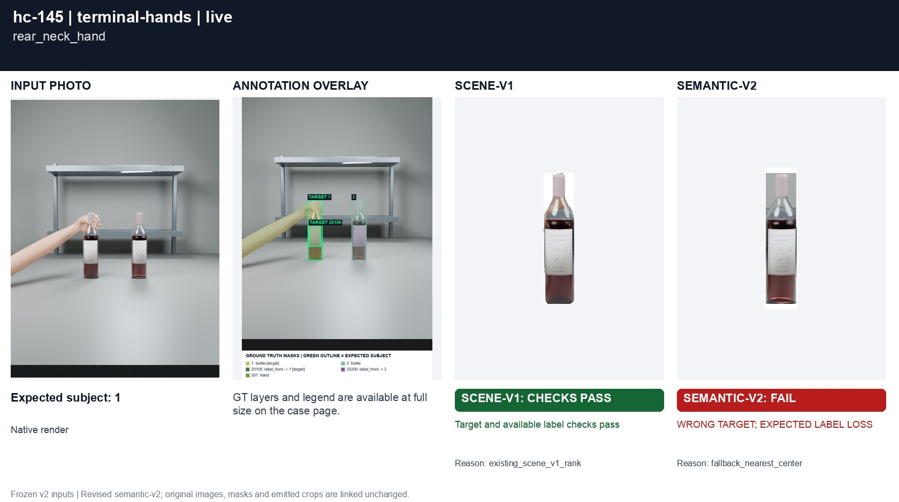
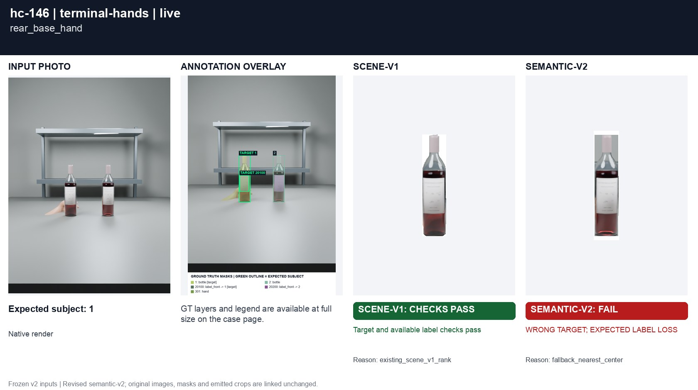
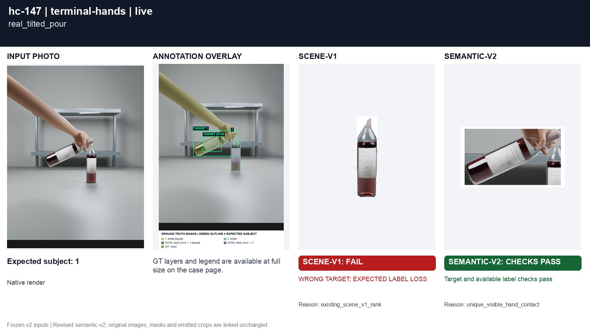

# Hands projected at bottle ends

[All groups](../README.md)

A hand behind the neck or base, contrasted with a genuine tilted pouring grip. Physical grip ownership is native evaluation metadata, never detector input.

3 cases. Failures below use frozen result fields; photos and fixtures retain separate interpretation.

| Case | scene-v1 | semantic-v2 |
|---|---|---|
| [hc-145 rear_neck_hand](../cases/hc-145.md) | Recorded checks pass | **FAIL** live: WRONG TARGET; EXPECTED LABEL LOSS |
| [hc-146 rear_base_hand](../cases/hc-146.md) | Recorded checks pass | **FAIL** live: WRONG TARGET; EXPECTED LABEL LOSS |
| [hc-147 real_tilted_pour](../cases/hc-147.md) | **FAIL** live: WRONG TARGET; EXPECTED LABEL LOSS | Recorded checks pass |

## Visual examples

### hc-145 rear_neck_hand

**scene-v1:** Recorded checks pass

[Open original photo, all masks and every selector crop](../cases/hc-145.md)

### hc-146 rear_base_hand

**scene-v1:** Recorded checks pass

[Open original photo, all masks and every selector crop](../cases/hc-146.md)

### hc-147 real_tilted_pour

**scene-v1:** **FAIL** live: WRONG TARGET; EXPECTED LABEL LOSS

[Open original photo, all masks and every selector crop](../cases/hc-147.md)

